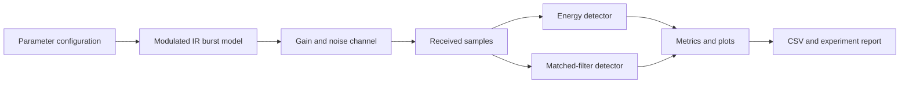

# System Overview

## Software modules
- `signal_model.py`: reference burst generation.
- `channel.py`: gain and additive noise.
- `detectors.py`: energy and matched-filter scores.
- `experiment.py`: repeated trials and SNR sweep.
- `__main__.py`: command-line interface.

## Future physical architecture
Potential blocks include an IR emitter and driver, optical path, photodiode or integrated IR receiver, analogue front end if needed, ADC/microcontroller, and host-side analysis. Components are not selected yet.
