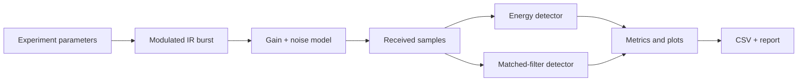

# IRIS — Infrared Sensing & Signal Processing Platform

  

**IRIS** is an open engineering project exploring modulated infrared (IR) signals, noise, and digital detection. The goal is to build a traceable path from repeatable signal-processing experiments to a carefully documented low-power physical prototype.

> **Current scope:** software simulation only. No physical prototype, measured detection range, calibrated optical sensitivity, or hardware performance is claimed.

## Current simulation result


The chart summarizes the committed CSV for nine SNR settings, with 100 simulated trials per point. The matched-filter curve is high for this particular reference waveform and threshold setup; this is not evidence of real-world range or performance. Threshold calibration, processing gain, and noise assumptions are key topics for the next experiment iteration.

Raw values: [metrics.csv](5_Simulations/results/metrics.csv)

## What it does today
- Generates a repeatable on/off-keyed sinusoidal burst.
- Applies scalar gain and additive Gaussian noise.
- Compares energy detection with matched-filter scoring.
- Runs Monte Carlo trials over a signal-to-noise ratio (SNR) sweep.
- Exports metrics to CSV and plots.
- Includes unit tests, architecture notes, requirements, limitations, and a staged roadmap.

## Repository map
```text
1_Project_Description/       requirements, roadmap, design decisions
2_System_Architecture/       architecture diagram and signal flow
3_Sensor_and_Power/          sensor evaluation and power-budget template
4_Schematics_and_Hardware/   hardware status and preliminary BOM
5_Simulations/               experiment plan and results
6_Application_Notes/         detection theory and limitations
7_Component_Datasheets/      component-document register
8_Utils/                     evidence and plotting conventions
9_Firmware_and_Software/     Python simulation package
docs/                        test plan, results, changelog
tests/                       automated unit tests
.github/workflows/           CI test workflow
```

## Quick start
Requires Python 3.10+.

```bash
python -m venv .venv
# Windows: .venv\Scripts\activate
# macOS/Linux: source .venv/bin/activate
python -m pip install -e ".[dev]"
pytest
python -m iris_sim --output 5_Simulations/results --trials 100
```

The simulation writes `waveform.png`, `detection_sweep.png`, and `metrics.csv` to the output directory.

## System architecture



## Engineering roadmap
1. **Simulation foundation:** implemented; six local unit tests passed.
2. **Stronger experiments:** improve threshold calibration, confidence intervals, sensitivity analysis, and reporting.
3. **Sensor and circuit selection:** compare receiver architectures using actual datasheets.
4. **Bench prototype:** build a safe, low-power setup and compare captured samples with simulation.
5. **Demonstration:** publish repeatable measurements only after documenting the setup and uncertainty.

See [the full roadmap](1_Project_Description/roadmap.md).

## Limitations and safety
The current model does not include optical power budgets, lens geometry, photodiode responsivity, shot noise, analogue-front-end bandwidth or saturation, ADC quantization, or measured ambient-light interference. It cannot establish detection distance or medical usefulness.

IR sources may present eye-safety risks depending on wavelength, optical power, and optics. Review manufacturer guidance before any physical build.

## Project principles
- Reproducible experiments and explicit assumptions.
- Clear separation of simulation results from bench measurements.
- Traceability from requirements to tests.
- Component selection based on datasheets, not guesses.
- Original implementation; repository organization is inspired by open engineering practice, not copied from another project.

## License
MIT — see [LICENSE](LICENSE).
