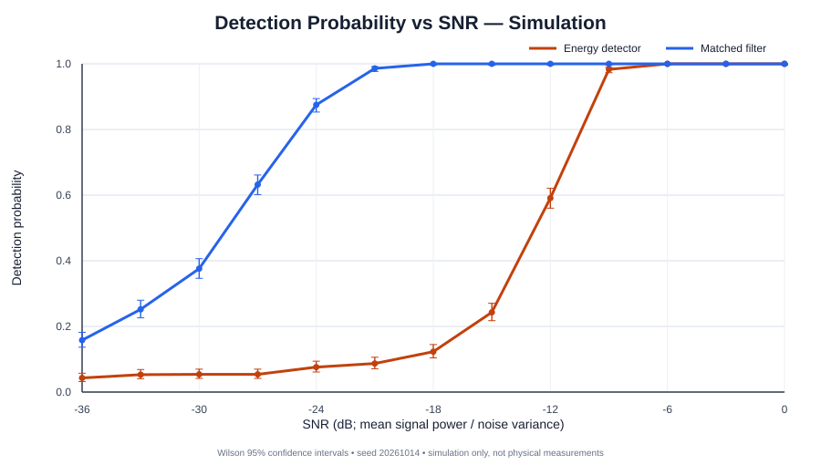
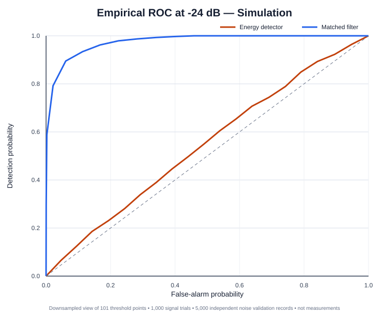

# IRIS — Infrared Sensing & Signal Processing Platform

  

**IRIS** is an open engineering project investigating detection of a known modulated infrared-like burst in noise. It begins with a reproducible signal-processing simulation and lays out a responsible path toward a receiver-specific physical prototype.

> **Scope:** current performance results are simulations using an idealized additive white Gaussian noise (AWGN) model. No circuit has been built or measured, and no optical range, sensitivity, medical utility, or real-world performance is claimed.

## Research question
At a fixed target false-alarm probability, how does detection probability change with SNR for an energy detector versus a matched filter detecting a known burst?

## Interactive simulation dashboard

**[Open the IRIS Simulation Control Room source](10_Simulation_Dashboard/index.html)** — adjust SNR, false-alarm target, trial count, and noise scale; run a browser-side Monte Carlo experiment; inspect waveform, detection sweep, ROC, confidence intervals, and export a CSV. It can be run locally by opening the HTML file. To publish a live website, follow the one-time [GitHub Pages setup instructions](10_Simulation_Dashboard/README.md).

The dashboard is a standalone educational model in the browser, separate from the Python CLI. It is not a physical receiver measurement.

## Simulation results

Baseline: 1,000 signal-present trials per SNR; 5,000 noise-only records for threshold calibration; 5,000 independent noise-only records for false-alarm validation; seed \`20261014\`; target false-alarm probability 5%.

- At -27 dB, simulated detection was 5.4% for energy detection and 63.2% for matched-filter detection (1,000 trials each).
- Independently validated false-alarm rates were 5.32% and 5.28%, respectively.
- These depend on the idealized model, reference waveform, thresholds, and SNR convention. They are not hardware performance claims.

Model note: [ambient-flicker interference assumptions and limitations](docs/ambient_interference_model.md).

Raw data: [metrics.csv](5_Simulations/results/metrics.csv) · [downsampled ROC coordinates (21 display points)](5_Simulations/results/roc_curve.csv) · [experiment protocol](5_Simulations/experiment_plan.md) · [validation notes](docs/test_results.md). Re-running the CLI exports the full 101-point ROC sweep.

## Implemented
- Deterministic on/off-keyed burst generation.
- Fixed-variance AWGN channel model and explicit SNR convention.
- Energy and matched-filter detector scores.
- Optional sinusoidal ambient-flicker interference in calibration, independent false-alarm validation, and signal-present Monte Carlo trials; randomized phase per record.
- Independent noise-only threshold calibration and false-alarm validation.
- Monte Carlo estimates with Wilson 95% confidence intervals.
- Empirical ROC curve at a configurable SNR.
- CSV metrics, plots, automated tests, and GitHub Actions.
- Preliminary receiver architecture study with manufacturer datasheet references.

## Quick start

Requires Python 3.10+.

\`\`\`bash
python -m venv .venv
# Windows: .venv\\Scripts\\activate
# macOS/Linux: source .venv/bin/activate
python -m pip install -e ".[dev]"
pytest
python -m iris_sim --output 5_Simulations/results --trials 1000 --seed 20261014
\`\`\`

Run the controlled ambient-interference sweep (default amplitudes 0, 0.1, 0.2, 0.4, 0.8; frequency 1 kHz):

\`\`\`bash
python -m iris_sim.sweep --output 5_Simulations/interference_sweep --trials 1000 --calibration-trials 5000 --validation-trials 5000
\`\`\`

This writes one run folder per amplitude plus `interference_sweep.csv`, which records detection rates, confidence intervals, and independently validated false-alarm rates. Amplitude uses arbitrary signal units; it is not a calibrated measure of ambient illumination.

Optional parameters:

\`\`\`bash
python -m iris_sim --trials 2000 --calibration-trials 10000 --validation-trials 10000 --target-false-alarm 0.01 --roc-snr -24
\`\`\`

The ROC SNR must be included in the sweep; the default includes -24 dB. Outputs: \`metrics.csv\`, \`roc_curve.csv\`, \`waveform.png\`, \`detection_sweep.png\`, and \`roc_curve.png\`.

## Architecture

\`\`\`mermaid
flowchart TD
    A[Reference burst and settings] --> B[Scale signal power for SNR]
    B --> C[Add fixed-variance AWGN]
    C --> D[Energy score]
    C --> E[Matched-filter score]
    F[Noise-only calibration set] --> G[Detector thresholds]
    G --> D
    G --> E
    H[Independent noise-only validation] --> I[False-alarm rates + confidence intervals]
    D --> J[Detection rates + confidence intervals]
    E --> J
    I --> K[CSV, plots, reproducible report]
    J --> K
\`\`\`

## Hardware direction — not yet built
Two architectures are under consideration:
1. **Simple digital demo:** compatible integrated IR receiver plus 940 nm emitter. Easier to prototype, but the demodulated output cannot validate raw analogue waveform samples directly.
2. **Waveform-focused research prototype:** BPW34 photodiode, designed transimpedance amplifier, and ADC/oscilloscope capture. More flexible but requires careful analogue design.

Candidate manufacturer documents:
- [Vishay TSSP940 receiver](https://www.vishay.com/docs/82843/tssp940.pdf)
- [Vishay BPW34 photodiode](https://www.vishay.com/docs/81521/bpw34.pdf)
- [Vishay TSAL6200 emitter](https://www.vishay.com/docs/81010/tsal6200.pdf)

These are candidates, not a finalized bill of materials. Verify exact variants, carrier compatibility, current limits, voltage levels, and safety requirements before buying or assembling.

## Roadmap
- [x] Reproducible burst and AWGN simulation.
- [x] Independent threshold calibration and false-alarm validation.
- [x] Wilson 95% intervals and empirical ROC export.
- [ ] Compare Monte Carlo results with analytical predictions.
- [x] Add a sinusoidal ambient-flicker model with parameter validation.
- [x] Integrate optional interference into threshold calibration, independent false-alarm validation, and detection trials.
- [x] Add a reproducible Monte Carlo sweep across multiple interference amplitudes with independent calibration and validation at each condition.
- [ ] Analyze sweep outputs and add a concise interpretation of observed robustness trends.
- [ ] Add timing mismatch.
- [ ] Select receiver architecture and design a reviewed circuit.
- [ ] Build a safe low-power bench prototype and record raw measurements.
- [ ] Validate the model against measurements.

## Scientific integrity and safety
Confidence intervals quantify Monte Carlo sampling uncertainty, not uncertainty in a physical receiver. The model omits optical geometry, photodiode responsivity and shot noise, analogue-front-end bandwidth/noise, ADC quantization, realistic ambient-light effects beyond the optional idealized sinusoidal stress test, and component tolerances. Do not infer detection range or medical applicability from this simulation.

IR may be invisible and still pose an eye hazard. Any future hardware work must follow manufacturer safety guidance and use a low-power, non-eye-directed setup.

## License
MIT; see [LICENSE](LICENSE).

## Research protocol

See [Robustness experiment protocol](docs/robustness_experiment_protocol.md) for the hypothesis, controlled variables, statistical reporting, and limitations for the ambient-interference sweep.

### Latest reproducible sweep

The controlled ambient-interference sweep has completed. See the [initial results report](5_Simulations/interference_sweep/RESULTS_REPORT.md), [summary CSV](5_Simulations/interference_sweep/interference_sweep.csv), and [detection plot](5_Simulations/interference_sweep/detection_vs_interference.png). Results are simulation-only and include explicit model limitations.

### Threshold-mismatch experiment

A second experiment tests the practical case where detector thresholds are calibrated in clean AWGN and the environment later gains periodic interference. See [mismatch experiment code](9_Firmware_and_Software/python/iris_sim/mismatch.py). Its results are generated automatically alongside the calibrated-condition sweep when the robustness workflow runs.
