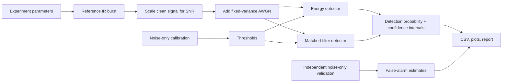

# IRIS — Infrared Sensing & Signal Processing Platform

  

**IRIS** is an open engineering project studying modulated infrared signals, digital detection, and the path from simulation to a documented low-power optical prototype.

> **Current status:** the software simulation and preliminary component trade study are in progress. No physical prototype, measured range, calibrated sensitivity, or hardware performance is claimed.

## Research question

At a stated false-alarm operating point, how does detection probability change with signal-to-noise ratio (SNR) for an energy detector versus a matched filter when detecting a known burst in additive white Gaussian noise?

## Current simulation baseline


The experiment uses 1,000 signal-present trials per SNR, 5,000 noise-only windows for threshold calibration, and 5,000 independent noise-only windows for false-alarm validation. It reports Wilson 95% confidence intervals. These are simulation results only.

- [Metrics CSV](5_Simulations/results/metrics.csv)
- [Experiment protocol](5_Simulations/experiment_plan.md)
- [Simulation validation record](docs/test_results.md)

## What is implemented
- Deterministic on/off-keyed burst generation.
- Fixed-variance AWGN channel and explicit SNR definition.
- Energy and matched-filter detector scores.
- Independent noise-only threshold calibration and false-alarm validation.
- Wilson 95% confidence intervals for Monte Carlo proportions.
- CSV and plots, automated tests, and GitHub Actions.
- Preliminary receiver architecture trade study using manufacturer datasheets.

## Quick start

Requires Python 3.10+.

```bash
python -m venv .venv
# Windows: .venv\Scripts\activate
# macOS/Linux: source .venv/bin/activate
python -m pip install -e ".[dev]"
pytest
python -m iris_sim --output 5_Simulations/results --trials 1000 --seed 20261014
```

Optional experiment controls:

```bash
python -m iris_sim --trials 2000 --calibration-trials 10000 --validation-trials 10000 --target-false-alarm 0.01
```

## System architecture



## Preliminary hardware direction

Two different receiver paths are documented; the project has **not** frozen a final BOM.

1. **Simple digital demonstrator:** a compatible Vishay TSSP94038 receiver module and a 940 nm emitter. This produces a demodulated digital output and is suitable for a first optical-link detection demo, but cannot validate raw analogue waveforms directly.
2. **Waveform research demonstrator:** Vishay BPW34 photodiode plus a designed transimpedance amplifier and ADC. This is more flexible for waveform capture but requires a reviewed analogue design.

A candidate 940 nm emitter is Vishay TSAL6200. Exact variants, carrier frequency, current limits, power budget, and eye-safety conditions must be checked before purchase or assembly.

- [TSSP940 receiver datasheet](https://www.vishay.com/docs/82843/tssp940.pdf)
- [BPW34 photodiode datasheet](https://www.vishay.com/docs/81521/bpw34.pdf)
- [TSAL6200 emitter datasheet](https://www.vishay.com/docs/81010/tsal6200.pdf)

See [sensor trade study](3_Sensor_and_Power/sensor_options.md) and [hardware design gate](4_Schematics_and_Hardware/hardware_status.md).

## Repository map

```text
1_Project_Description/       requirements, roadmap, design decisions
2_System_Architecture/       architecture and signal flow
3_Sensor_and_Power/          sensor trade study and power budget
4_Schematics_and_Hardware/   design gate and preliminary BOM
5_Simulations/               experiment protocol and results
6_Application_Notes/         detector theory and model limitations
7_Component_Datasheets/      manufacturer-document register
8_Utils/                     evidence and plotting conventions
9_Firmware_and_Software/     Python simulation package
docs/                        test plan, validation record, changelog
tests/                       automated tests
.github/workflows/           CI test workflow
```

## Roadmap
1. **Simulation:** improve statistical validity and reproducibility (in progress).
2. **Circuit design:** select receiver path and document a reviewed schematic.
3. **Bench prototype:** capture repeatable data with setup and uncertainty recorded.
4. **Model validation:** compare measured results with a receiver-specific model.
5. **Research report:** publish methods, limitations, code, and evidence.

## Safety and scientific integrity
Infrared sources can present eye-safety risks even when the beam is not visible. Review the manufacturer's eye-safety guidance and operate only a low-power, non-eye-directed setup. Do not infer range or medical applicability from the simulation.

## License
MIT — see [LICENSE](LICENSE).
